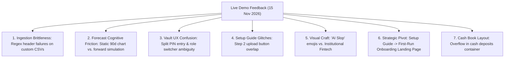

# Live Demo Review & Team Feedback Synthesis (15 Nov 2026)

> **Source Event:** Google Meet Session `ijt-mtka-pgm` (43:06 duration)  
> **Session Timestamp:** 15 November 2026, 15:29 – 16:12 GMT+5:30  
> **Attendees:**  
> - Dr. Ishaan Wadhwa (Founder & Technical Lead)  
> - Alok Ae (Technical & UI Reviewer)  
> - Harshit Sahu (QA & UX Lead)  
> - Shourya Gupta (Engineering)  
> - Dr. Ishaan's Assistant (Automated Transcriber)  
> **Codebase State:** As of commit `c14282e` on `main`  

---

## 1. Executive Summary of Feedback

On 15 November 2026 at 15:29 IST, the team conducted a live user demonstration and stress-test of the running production copilot on [https://sme-cashflow.medevolv.in](https://sme-cashflow.medevolv.in). 

The core financial mechanics—vernacular audio briefing playback, Decision 60 reconciliation, salesman WhatsApp recovery deep links (`wa.me`), and dual-plane sovereign vault security—functioned reliably and received positive validation. However, user interaction revealed **7 critical friction points** across custom file uploads, forecast comprehensibility, vault gating ergonomics, setup wizard layout, and visual craft.

---

## 2. Detailed Feedback Breakdown & Root Cause Analysis

### 2.1 Custom Statement Ingestion Failure (Regex Header Mismatch)
- **Observed Behavior:** Alok attempted to upload a custom sample dataset (`Retail India` CSV / bank statement). The application crashed with:
  > *"Could not find Date column / Bank statement column"*
  Even after Alok inspected the file and confirmed columns (`Tax date, Narration ID, business ID, narration, channel date`), the parser rejected it due to rigid header naming expectations.
- **Root Cause (corrected after reproduction):** the Excel reader only read the workbook's first sheet, a `README`; the transactions are on `bank_transactions`. Column naming was not the cause. Fixed 15 Nov — see [statement-ingestion-regex.md](subsystems/statement-ingestion-regex.md) section 0.
- **Decision:** As agreed by Dr. Ishaan, implement flexible regex-based column normalization (e.g. matching `.*date.*`, `.*narrat.*`, `.*desc.*`, `.*credit.*`, `.*debit.*`) and provide clear user remediation when required fields cannot be inferred.

### 2.2 Forecast Page: "Static Looking-Back" vs. Actionable Forward Prediction
- **Observed Behavior:** Alok noted that opening the Forecast graph provides little intuitive clarity to an SME owner (*"If I don't know shit and I open the forecast graph, I'm not able to understand graph"*). Furthermore, the current visualization displayed historical data (July to September 30) rather than a dynamic forward forecast from a user-selected date.
- **Root Cause:** The chart plotted holdout evaluation data without an explicit narrative card explaining *"What this means for your money"* and lacked interactive forecast controls.
- **Decision:** 
  1. Add a plain-language executive summary card directly below the forecast fan chart.
  2. Implement interactive timeline controls allowing the user to select the forecast starting anchor date.
  3. Introduce simulation scenario toggles (e.g., *"What if debtor payments are delayed by 15 days?"* or *"What if GST payment is deferred to the 25th?"*).

### 2.3 Sovereign Vault PIN & Role Switcher Ergonomics
- **Observed Behavior:** Harshit and Alok experienced confusion trying to unlock the Sovereign Vault. Harshit attempted unlocking with PIN `0000` while viewing as Accountant, and experienced uncertainty about whether the PIN should be entered in the sidebar or directly on the Cash Book page (*"It's not unlocking from here. But he has to unlock over there... Now accountant log in"*).
- **Root Cause:** Dual entry points for the PIN (sidebar card vs. page inline card) combined with the role dropdown created cognitive friction.
- **Decision:** Unify the PIN entry into a prominent, unambiguous contextual dialog, with explicit status badges explaining that **Accountant mode cannot decrypt sovereign cash unless the Owner has explicitly toggled sharing**.

### 2.4 Setup Guide Layout Glitch & Strategic Landing Page Evolution
- **Observed Behavior:** In Step 2 of the Setup Guide, the "Upload file" button visually overlapped with the surrounding upload dropzone container. Furthermore, Alok and Ishaan noted that having the Setup Guide as an internal sub-page (Page 8) feels inverted.
- **Strategic Decision:** Evolve the initial entry experience into a dedicated first-run **Onboarding Landing Page**:
  - Welcomes the user with a clean business archetype selector (FMCG Wholesale, Healthcare Clinic, Creative Agency).
  - Integrates lightweight Google Authentication (free, reliable, avoids Firebase bloat).
  - Once authenticated, transitions smoothly into the main operational cockpit.

### 2.5 Visual Craft: Eliminating "AI Slop" Emojis
- **Observed Behavior:** Alok gave strong feedback on UI aesthetics:
  > *"I think emojis is very AI-like... It's clean and nice, but the emojis is very AI-like apart from that."*
- **Decision:** Remove non-standard unicode emojis (🪙, 👑, 🔴, 🟢, 📥, 📊) across headers, buttons, and badges. Replace with custom, high-craft SVG icons or clean typographic status pills (e.g., Lucide-style strokes, consistent `#0F172A` / `#64748B` palette).

### 2.6 Ask Copilot: Enabling Open-Ended Typing with Safety Guardrails
- **Observed Behavior:** Users are currently restricted to pre-set question chips because freeform LLM execution was gated for safety and token cost concerns.
- **Decision:** Introduce a controlled freeform text input with client-side rate limiting and fail-closed regex intent routing.

### 2.7 Cash Book UI Overflow
- **Observed Behavior:** In the Cash Book page, the "Cash deposits of this year" summary card exhibited a horizontal/vertical layout overflow on certain screen widths.
- **Decision:** Adjust flexbox wrapping and overflow clamping on `.cc-card-modern` in `app/streamlit_app.py`.

---

## 3. Tactical Action Plan & Ownership Matrix

| ID | Issue / Feature | Priority | Target File(s) | Owner | Success Metric |
| :--- | :--- | :--- | :--- | :--- | :--- |
| **ACT-01** | Fuzzy regex column normalization for custom bank statement CSVs | **P0** | `src/copilot/ingest.py`, `src/copilot/load.py` | Eng / Data | Clean ingestion of `Retail India` CSV without column crashes — **DONE 15 Nov** (cause was sheet selection, not column names) |
| **ACT-02** | Add plain-language narrative summary & dynamic start date to Forecast | **P0** | `app/streamlit_app.py`, `src/copilot/forecast/engine.py` | Product / UI | Plain-English card rendered below fan chart — **DONE 15 Nov**: forecast now starts from the books date (30 Sep) by default with a start-date picker, three what-if toggles and the card, in Streamlit, the API (`plainSummary`) and the web app |
| **ACT-03** | De-AI-ify UI: Replace unicode emojis with clean SVG icons | **P1** | `app/streamlit_app.py`, `apps/web/` | Design / UI | Zero amateurish emojis; WCAG compliant SVGs — **DONE 15 Nov** in Streamlit and `apps/web/src` |
| **ACT-04** | Fix Setup Guide step 2 upload overlap and Cash Book overflow | **P1** | `app/streamlit_app.py` | UI | Clean bounding boxes without CSS overlaps — **DONE 15 Nov**. The "overlap" was Material icon names (`upload_file`, `visibility_off`) rendering as text because the global font rule only exempted one icon element; the deposits panel overflow was a fixed-minimum hero number |
| **ACT-05** | Streamline Sovereign Vault unlock dialog & role permissions | **P1** | `app/streamlit_app.py`, `src/copilot/vault/` | Security / UI | Unambiguous 1-click PIN entry modal — **PARTLY DONE 15 Nov**: non-owner roles now see an explanation instead of a PIN field that can never work. Not a modal (16 existing tests drive the two PIN fields). Open issue: the "Share my cash book with my accountant" toggle no longer changes anything, so the wording "unless Share with Accountant is enabled" was not used |
| **ACT-06** | Open-ended prompt input in Ask Copilot with boundary checks | **P2** | `app/streamlit_app.py`, `src/copilot/boundary.py` | AI Eng | Freeform questions answered within budget — **NOT CHANGED in Streamlit**: typing already works locally; on the public deployment it is deliberately off behind `COPILOT_PUBLIC=1` and enforced by `tests/test_public_safety.py`. Turning it on publicly is a team decision. Free text with a pre-check was added to the web app |
| **ACT-07** | Design First-Run Onboarding Landing Page with Google Auth | **P2** | `docs/specs/`, `apps/web/` | Architecture | Modern landing flow mapped into Next.js App Router — **DONE 15 Nov** as `/` in the web app (Google sign-in, upload and Account Aggregator shown as "Coming soon", not implemented); Streamlit shows "Start here" first in the nav plus a first-run prompt |
